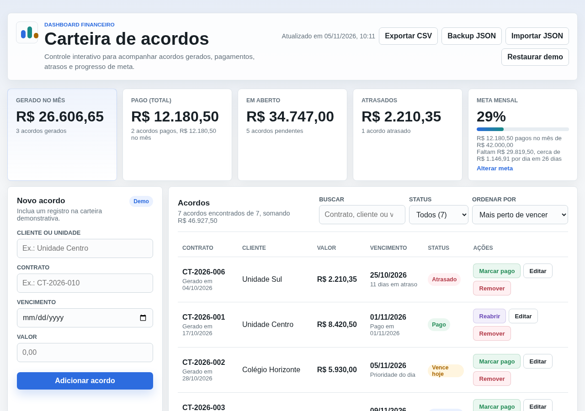
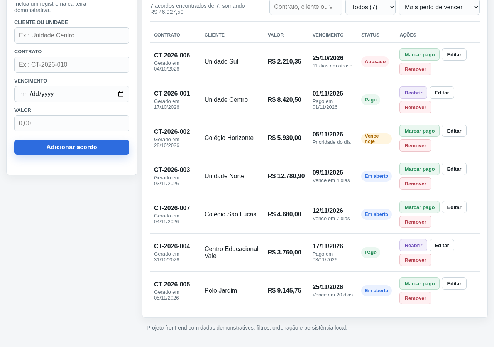
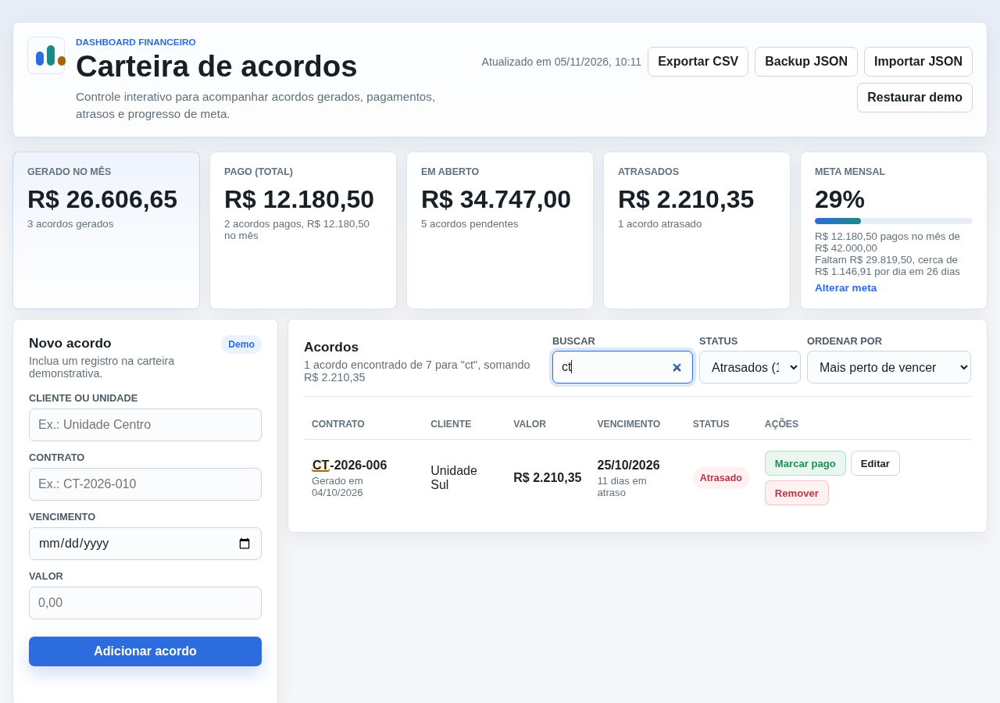
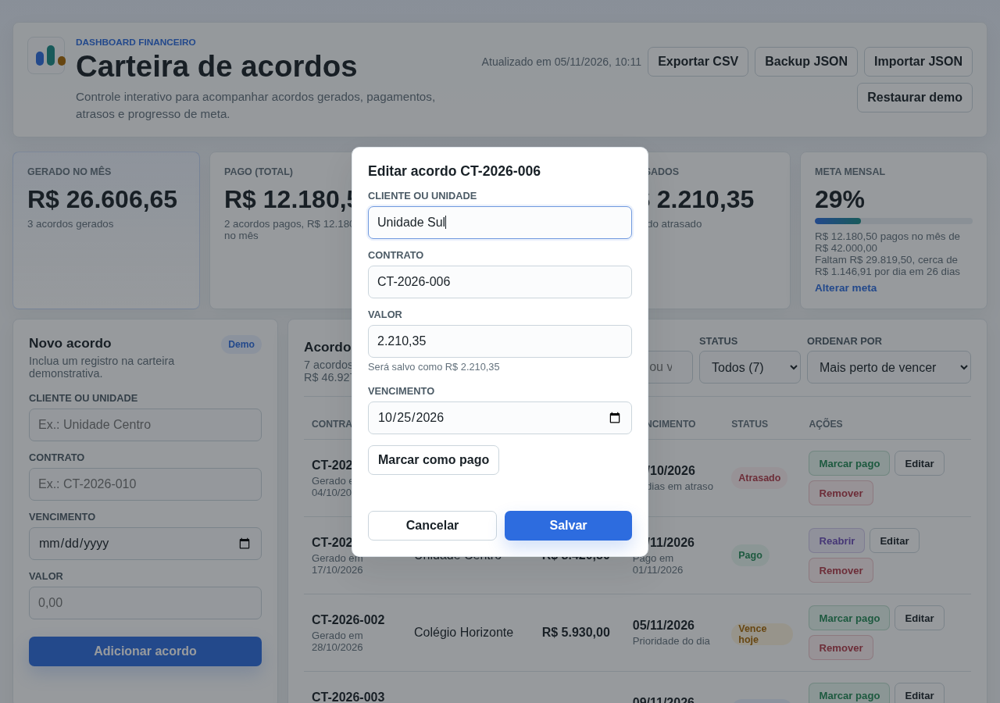
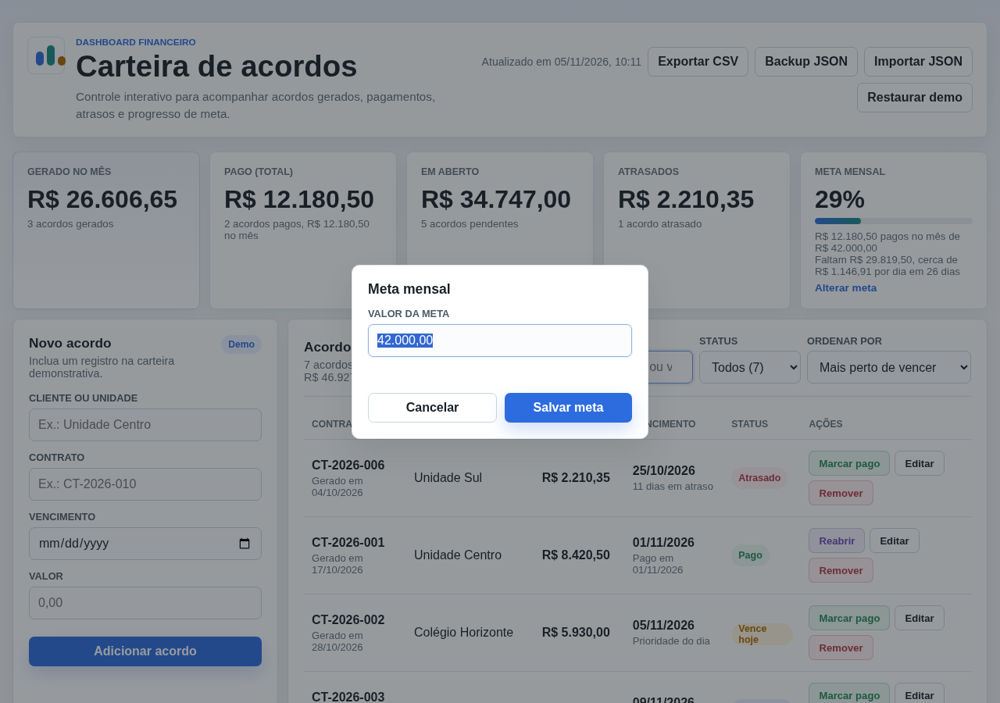
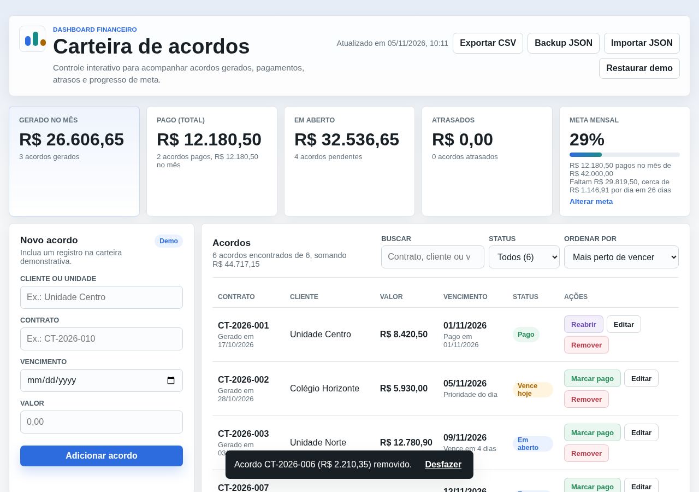
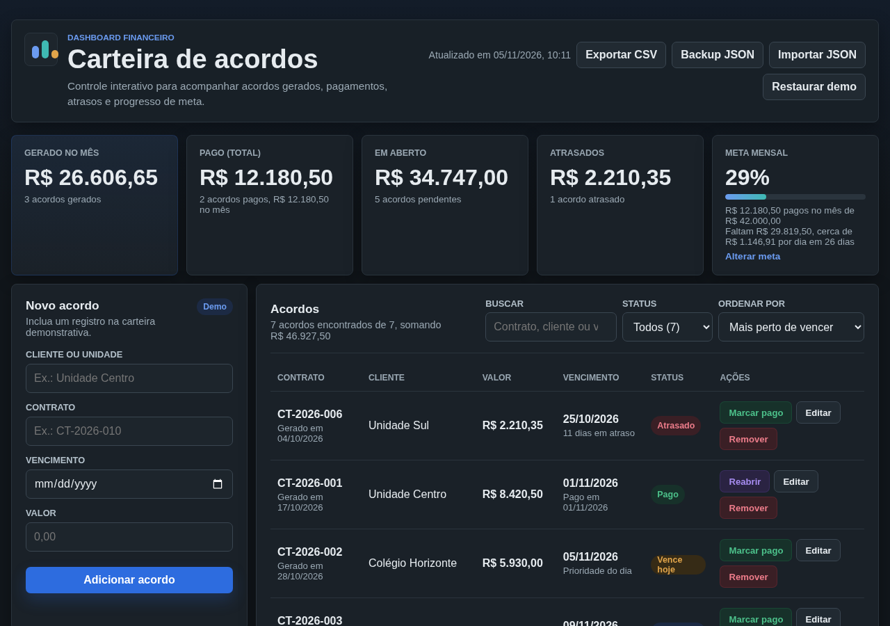
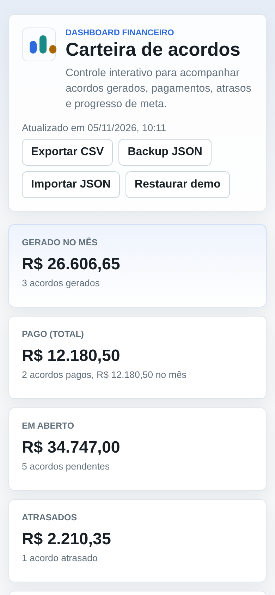

# Carteira de Acordos: Agreement Tracking Dashboard

[](https://github.com/brunohinz/carteira-acordos/actions/workflows/ci.yml)

**Live demo:** https://brunohinz.github.io/carteira-acordos/



## Overview

Carteira de Acordos is a front-end dashboard for tracking financial agreements (payment agreements), built as a portfolio project with **plain HTML, CSS and JavaScript**, without frameworks. Everything runs in the browser and is saved with `localStorage`. All data shown is fictitious.

## Features

- KPIs: amount generated this month, amount paid (total and paid this month), amount open, and overdue count. The paid, open and overdue cards have a "Ver na lista" shortcut that applies the matching filter.
- A configurable monthly goal ("Alterar meta"), calculated only from agreements paid in the current month, showing how much is left and the daily pace needed until month end. The card turns green once the goal is met.
- Demo dataset included, and you can restore it at any time (agreements, filters and search reset, and the monthly goal returns to R$ 42.000,00).
- Create agreements with a formatted-value preview and due-date validation. Client (up to 120 characters) and contract (up to 40) are saved without repeated spaces.
- Edit client, contract, amount and due date in an accessible dialog (blocks duplicate contracts and previews the amount). The dialog can also mark the agreement as paid or reopen it (suggesting today's date), and for paid agreements you can fix the payment date.
- Search by contract, client or amount (8.420,50, 8420,50 or 8420.50), ignoring accents and case, with the matching text highlighted in the list. `/` jumps to the search box and `Esc` clears it.
- The list summary shows how many agreements are visible and their total amount.
- Status filters: all, open, paid, overdue, due today, and next 7 days, each showing how many agreements it matches. The tab title shows how many are overdue.
- Sort by due date, creation date, amount or client (A-Z / Z-A).
- Mark agreements as paid, reopen them, and delete them with undo; the notice shows the removed contract and amount (`Esc` dismisses it).
- **CSV export** of the current view. It respects search and filters and opens directly in Excel with pt-BR settings, and ends with a total row; the file name includes the active filter.
- **JSON backup and import**. The import validates the data and skips duplicate contracts. Before replacing anything, the confirmation shows how many agreements come from the file and how many the current portfolio has, and if the file's goal differs from the current one it quotes both values because the file's goal will be applied too.
- Persists agreements, filters, search and goal in `localStorage`.
- With the app open in two tabs, each one picks up the agreements and goal saved by the other instead of overwriting them, and announces the change (screen readers included); if the agreement being edited is removed in the other tab, the edit dialog closes with a notice, and an open goal dialog shows the new goal unless you already typed a different value.
- Statuses and KPIs refresh automatically when you return to the tab on a new day.
- Responsive layout for desktop and mobile, automatic dark mode (follows the system), a print view (KPIs and list only), and support for `prefers-reduced-motion`.

## Tech stack

- HTML, without frameworks
- CSS (Grid and Flexbox, responsive)
- Vanilla JavaScript for state, rendering, filters, sorting and financial calculations
- `localStorage` for persistence
- `node --test` for unit tests plus a jsdom DOM smoke test (the app itself has no dependencies), with CI on GitHub Actions (Node 20 and 22)

## Getting started

Open the live demo, or run it locally:

```bash
git clone https://github.com/brunohinz/carteira-acordos.git
cd carteira-acordos
# open index.html in your browser
```

Tests (Node.js 20+):

```bash
npm install     # installs jsdom (tests only)
npm test        # unit tests, a DOM smoke test (add, filter, export, edit, undo, import, tab sync, full storage) and a dark mode CSS check
npm run check   # syntax check of utils.js and script.js
```

## Project structure

```text
index.html                 App markup
favicon.svg                Tab icon
style.css                  Styles and responsiveness
script.js                  State, rendering and DOM interactions
utils.js                   Pure functions: currency, dates, filters, CSV, backup, storage
tests/utils.test.js        Unit tests for the pure functions
.github/workflows/ci.yml   Check + tests on every push
```

## Screenshots

| New agreement | "Atrasados" (overdue) filter + search |
|---|---|
|  |  |

| Edit dialog | Change goal (daily pace on the card) |
|---|---|
|  |  |

| Undo delete | Dark mode |
|---|---|
|  |  |

Mobile layout (about 390 px):



## What this project demonstrates

DOM manipulation without frameworks, client-side state management, filtering, search and sorting, financial KPI calculations, browser persistence, a responsive admin-style layout, and automated tests with CI.

## Note

All data is fictitious and exists only to demonstrate the interface and workflow.
