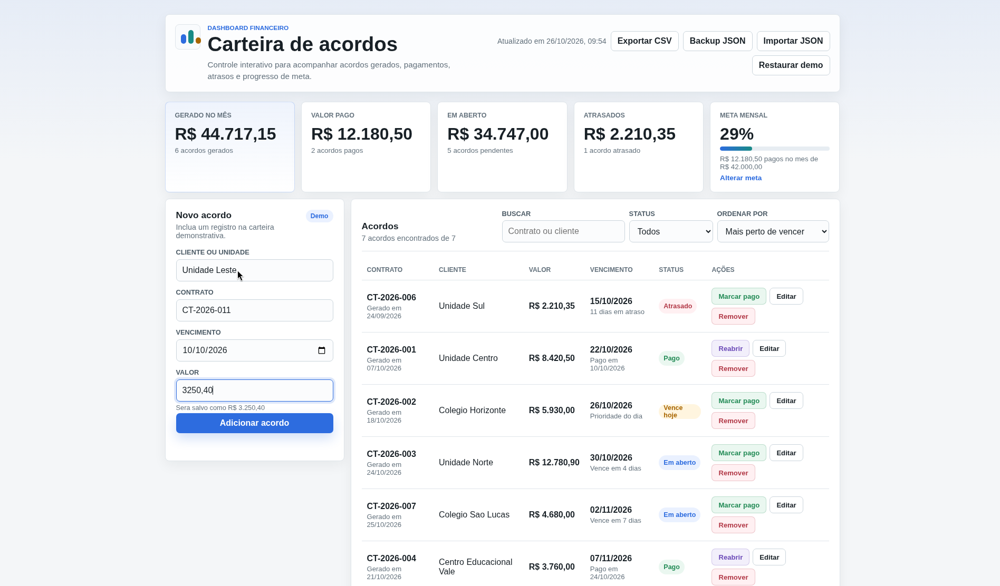
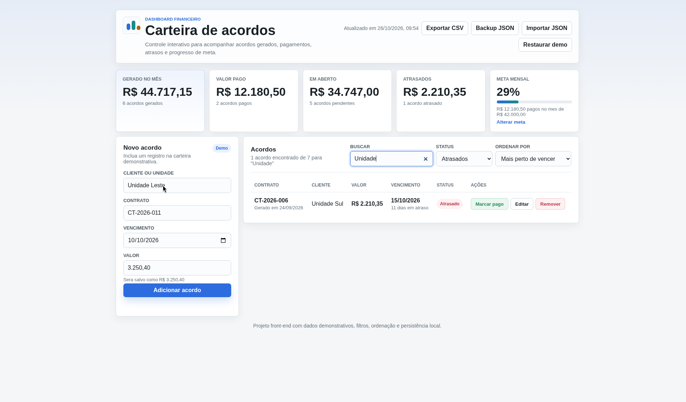
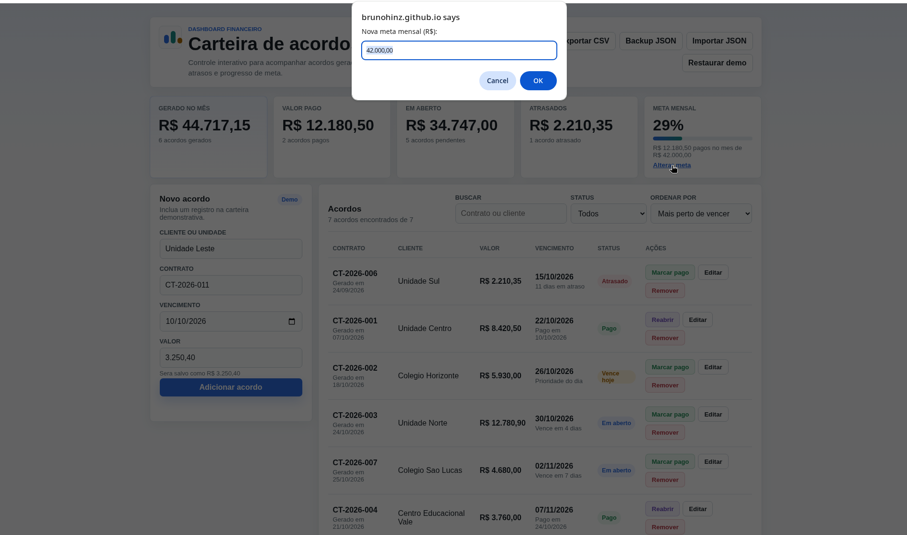
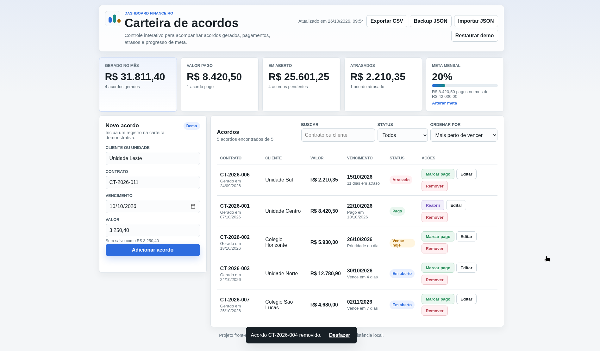
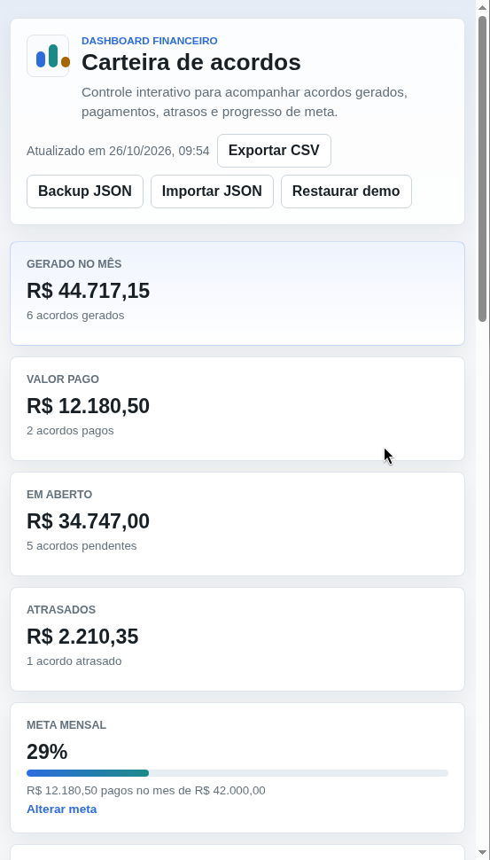

# Carteira de Acordos

[](https://github.com/brunohinz/carteira-acordos/actions/workflows/ci.yml)

🇬🇧 [English version](README.en.md)


Dashboard front-end para acompanhamento de acordos financeiros, criado como projeto de portfolio com HTML, CSS e JavaScript puro.

## Funcionalidades

- Indicadores de valor gerado no mês, valor pago (total e quanto foi pago no mês), valor em aberto e atrasos.
- Meta mensal configurável (botão "Alterar meta"), calculada só com os acordos pagos no mês corrente, mostrando quanto falta e o ritmo diário necessário até o fim do mês.
- Base inicial com acordos demonstrativos.
- Cadastro de novos acordos, com prévia do valor formatado e validação de vencimento.
- Edição de cliente, contrato, valor e vencimento em um diálogo acessível (bloqueia contrato duplicado e mostra a prévia do valor).
- Busca por contrato, cliente ou valor (8.420,50, 8420,50 ou 8420.50), sem diferenciar acentos e maiúsculas (Esc limpa a busca).
- Filtro por status: todos, em aberto, pagos, atrasados, vence hoje e próximos 7 dias.
- Ordenação por vencimento, por data de geração ou por valor.
- Marcação de acordos como pagos, reabertura e remoção com opção de desfazer.
- Exportação da lista atual em CSV (respeita busca e filtros, abre direto no Excel em pt-BR).
- Backup completo em JSON e importação de um backup (valida os dados e ignora contratos duplicados).
- Restauração da base demonstrativa.
- Persistência local com `localStorage` (acordos, filtros, busca e meta).
- Status e indicadores se atualizam sozinhos ao voltar para a aba em um novo dia.
- Layout responsivo para desktop e celular.

## Capturas de tela

As capturas abaixo são de uma versão anterior; a edição em diálogo e o ritmo da meta ainda não aparecem nelas.

| Novo acordo | Filtro "Atrasados" + busca |
|---|---|
|  |  |

| Alterar meta | Desfazer exclusão |
|---|---|
|  |  |

Versão mobile (cerca de 390 px):



## O que este projeto demonstra

- Manipulação de DOM com JavaScript puro.
- Controle de estado da aplicação no front-end.
- Filtros, busca e ordenação de registros.
- Cálculo e atualização de indicadores financeiros.
- Persistência de dados no navegador com localStorage.
- Layout responsivo com CSS Grid e Flexbox.
- Testes automatizados das regras de moeda, datas, filtros, backup e armazenamento com `node --test` e CI no GitHub Actions.
- Organização de uma interface administrativa em formato de dashboard.

## Tecnologias

- HTML sem frameworks.
- CSS responsivo com Grid e Flexbox.
- JavaScript puro para estado, renderização, filtros, ordenação e cálculos financeiros.
- `localStorage` para manter as interações da demo no navegador.

## Como visualizar

Acesse a demo online:

https://brunohinz.github.io/carteira-acordos/

Ou abra o arquivo `index.html` localmente no navegador.

## Estrutura

```text
index.html                 Estrutura da aplicação
favicon.svg                Ícone da aba do navegador
style.css                  Estilos e responsividade
script.js                  Estado, renderização e interações (DOM)
utils.js                   Funções puras: moeda, datas, filtros, CSV, backup e armazenamento
tests/utils.test.js        Testes das funções puras
tests/smoke.test.js        Smoke test de DOM (jsdom): adicionar, filtrar, exportar, editar, desfazer e importar
.github/workflows/ci.yml   Check e testes automáticos a cada push
```

## Como rodar os testes

Requer Node.js 18 ou superior. O app não tem dependências; o `jsdom` é usado só no smoke test de DOM:

```bash
npm install     # instala o jsdom (só para os testes)
npm test        # testes unitários + smoke test de DOM com node --test
npm run check   # verifica a sintaxe de utils.js e script.js
```

## Observação

Os dados exibidos são fictícios e servem apenas para demonstrar a interface e o fluxo de uso.
