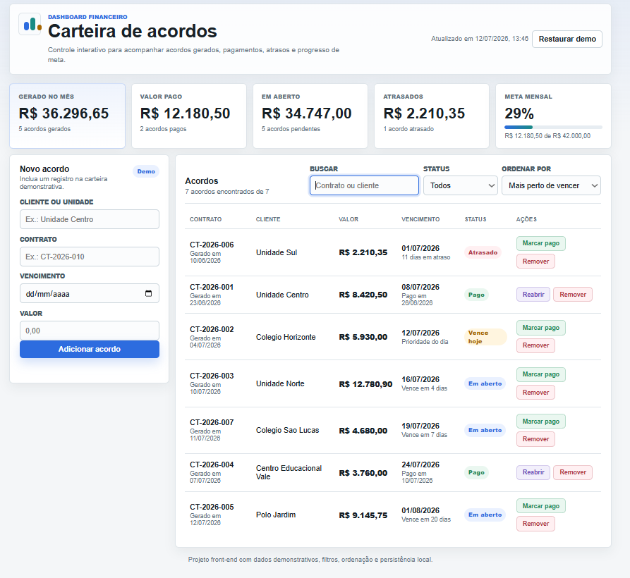

# Carteira de Acordos



Dashboard front-end para acompanhamento de acordos financeiros, criado como projeto de portfolio com HTML, CSS e JavaScript puro.

## Funcionalidades

- Indicadores de valor gerado no mes, valor pago, valor em aberto, atrasos e progresso de meta.
- Base inicial com acordos demonstrativos.
- Cadastro de novos acordos.
- Busca por contrato ou cliente.
- Filtro por status: todos, em aberto, pagos e atrasados.
- Ordenacao por vencimento ou por data de geracao.
- Marcacao de acordos como pagos, reabertura e remocao.
- Restauracao da base demonstrativa.
- Persistencia local com `localStorage`.
- Layout responsivo para desktop e celular.

## O que este projeto demonstra

- Manipulação de DOM com JavaScript puro.
- Controle de estado da aplicação no front-end.
- Filtros, busca e ordenação de registros.
- Cálculo e atualização de indicadores financeiros.
- Persistência de dados no navegador com localStorage.
- Layout responsivo com CSS Grid e Flexbox.
- Organização de uma interface administrativa em formato de dashboard.

## Tecnologias

- HTML sem frameworks.
- CSS responsivo com Grid e Flexbox.
- JavaScript puro para estado, renderizacao, filtros, ordenacao e calculos financeiros.
- `localStorage` para manter as interacoes da demo no navegador.

## Como visualizar

Abra o arquivo:

```text
index.html
```

Ou publique o repositorio no GitHub Pages. Como a aplicacao principal esta em `index.html`, o Pages carrega o dashboard automaticamente.

## Estrutura

```text
index.html   Estrutura da aplicacao
style.css    Estilos e responsividade
script.js    Regras de negocio e interacoes
```

## Observacao

Os dados exibidos sao ficticios e servem apenas para demonstrar a interface e o fluxo de uso.
